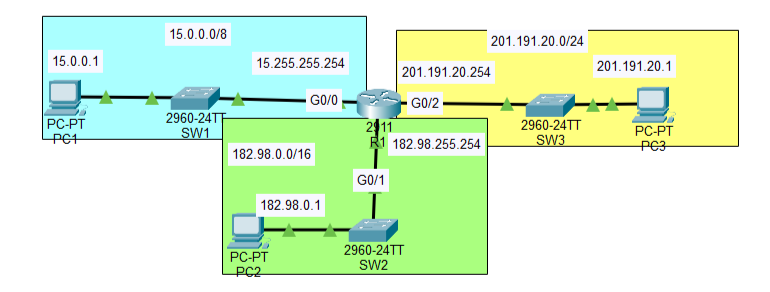

# Day 02 — IPv4 Addressing

**Jeremy's IT Lab:** Day 07 | **Topic:** N10-009 Obj 1.4 — IP Addressing
**Difficulty:** ⭐ Easy

---

## 🎯 Objective
Configure IP addresses on R1's interfaces and on three PCs, then verify connectivity with ping.

## 🖧 Topology


## 📋 IP Addressing Table

| Device | Interface | IP Address | Subnet Mask | Default Gateway |
|---|---|---|---|---|
| PC1 | NIC | 15.0.0.1 | 255.0.0.0 | 15.255.255.254 |
| PC2 | NIC | 182.98.0.1 | 255.255.0.0 | 182.98.255.254 |
| PC3 | NIC | 201.191.20.1 | 255.255.255.0 | 201.191.20.254 |
| R1 | Gi0/0 | 15.255.255.254 | 255.0.0.0 | — |
| R1 | Gi0/1 | 182.98.255.254 | 255.255.0.0 | — |
| R1 | Gi0/2 | 201.191.20.254 | 255.255.255.0 | — |

## ⚙️ Key Commands Used

```bash
Router(config)# hostname R1
R1(config)# interface g0/0
R1(config-if)# ip address 15.255.255.254 255.0.0.0
R1(config-if)# description ## Connected to SW1 ##
R1(config-if)# no shutdown
# repeat for g0/1 and g0/2

R1# show ip interface brief
R1# show running-config
R1# write memory
PC> ping 182.98.0.1
```

## ✅ Verification Results
- PC1 → PC2 ping: ✅ / ❌
- PC1 → PC3 ping: ✅ / ❌


## 💡 What I Learned
- Each router interface is the **default gateway** of its LAN.
- Directly connected networks need **no routes**, the router knows them once the interface is up.
- Interfaces stay `administratively down` until `no shutdown`.
- Save the config with `write memory`.

## ❌ Mistakes I Made
<!-- What went wrong in this lab and what did you learn from it -->

## 📎 Files
- `ipv4-addressing.pkt` — Packet Tracer file

---
*Source: Jeremy's IT Lab Day 07 | N10-009 Obj 1.4*