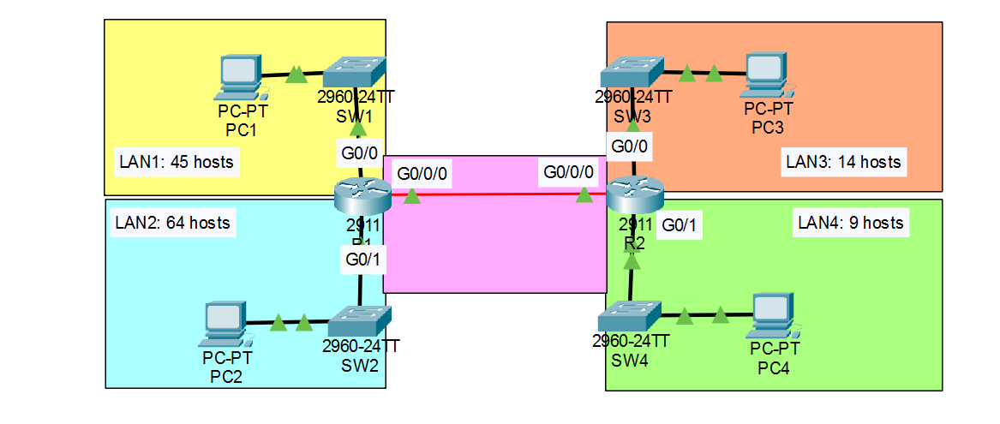

# Day 03 — Subnetting

**Jeremy's IT Lab:** Day 08 (theory) + Day 15 Lab (VLSM) | **Topic:** N10-009 Obj 1.4 — Subnetting
**Difficulty:** 🟡 Medium 

---

## 🎯 Objective
Subnet `192.168.5.0/24` with **VLSM** so that four LANs and one router-to-router link all get a correctly sized subnet. Give each PC the **first** usable address and each router LAN interface the **last** usable address, then verify devices in different subnets communicate through the routers.

## 🖧 Topology


  
## 📋 Subnetting Work

### Step 1: size each subnet (largest first)

Needed = hosts + 1 router interface. The block must have **usable (2ⁿ − 2) ≥ needed**.

| LAN | Hosts | Needed | Block (usable) | Prefix | Mask |
|---|---|---|---|---|---|
| LAN2 | 64 | 65 | 128 (126) | /25 | 255.255.255.128 |
| LAN1 | 45 | 46 | 64 (62) | /26 | 255.255.255.192 |
| LAN3 | 14 | 15 | 32 (30) | /27 | 255.255.255.224 |
| LAN4 | 9 | 10 | 16 (14) | /28 | 255.255.255.240 |
| R1–R2 link | 2 | 2 | 4 (2) | /30 | 255.255.255.252 |

### Step 2: allocate one after another (no gaps, no overlap)

| Subnet | Network Address | Subnet Mask | First Host (PC) | Last Host (router) | Broadcast |
|---|---|---|---|---|---|
| LAN2 | 192.168.5.0/25 | 255.255.255.128 | 192.168.5.1 | 192.168.5.126 | 192.168.5.127 |
| LAN1 | 192.168.5.128/26 | 255.255.255.192 | 192.168.5.129 | 192.168.5.190 | 192.168.5.191 |
| LAN3 | 192.168.5.192/27 | 255.255.255.224 | 192.168.5.193 | 192.168.5.222 | 192.168.5.223 |
| LAN4 | 192.168.5.224/28 | 255.255.255.240 | 192.168.5.225 | 192.168.5.238 | 192.168.5.239 |
| R1–R2 | 192.168.5.240/30 | 255.255.255.252 | R1 192.168.5.241 | R2 192.168.5.242 | 192.168.5.243 |

```
.0                .128          .192        .224     .240 .244        .255
|     LAN2        |    LAN1     |    LAN3   |  LAN4  | P2P |   free    |
|     /25         |    /26      |    /27    |  /28   | /30 |   (12)    |
```

Each next network = previous broadcast + 1.

## ⚙️ Key Commands Used

```bash
# Verify subnets on router
Router# show ip route
Router# show ip interface brief

# Test from PC
PC> ping [ip of device in another subnet]
PC> ipconfig
```

## ✅ Verification Results
- Devices in same subnet ping each other: ✅ / ❌
- Devices in different subnets ping through router: ✅ / ❌ (needs the static routes from Day 04)


## 💡 What I Learned
- **Borrowing bits** gives more subnets but **fewer hosts each**. The total never grows: a /24 always has 256 addresses.
- **Borrow bits (FLSM)** when all subnets are the same size. **Use VLSM** when sizes differ a lot. Quick test: block for the biggest LAN × number of LANs. Here 128 × 4 = 512 > 256, so equal subnets can't fit.
- VLSM rule: **sort largest → smallest**, then each network starts right after the previous broadcast.
- **Magic number (block size) = 256 − mask value** of the interesting octet. It is the jump between subnets.
- **Count the router interface** as a host on each LAN, and subtract 2 (network + broadcast).
- Use **/30** for a point-to-point link (2 usable addresses).
-  **First usable** = network + 1. &nbsp; &nbsp;
 **Last usable** = broadcast − 1.

## ❌ Mistakes I Made

| Mistake | Why it's wrong | Correct |
|---|---|---|
| Went to `192.168.4.0/23` and wrote `2⁹ = 512` | That is **removing** a network bit (supernetting), and it leaves the given `192.168.5.0/24` | Only borrow from the host side: the prefix gets **longer** (/25, /26...) |
| Wrote `255.255.252.0` for /23 | `255.255.252.0` is /22. /23 is `255.255.254.0` | Learn the mask table: 128, 192, 224, 240, 248, 252, 254 |
| Prefixes like `/2` | Not a real subnet prefix here | Always write the full prefix, e.g. `/26` |
| Sizing LAN3 as a /28 (14 hosts fit) | 14 PCs + the router interface = **15** usable needed, a /28 has only 14 | **/27** (30 usable) |

## 📎 Files
- `subnetting.pkt` — Packet Tracer file (my copy of *Day 15 Lab - VLSM.pkt*)

---
*Source: Jeremy's IT Lab Day 08 and Day 15 Lab | N10-009 Obj 1.4*
