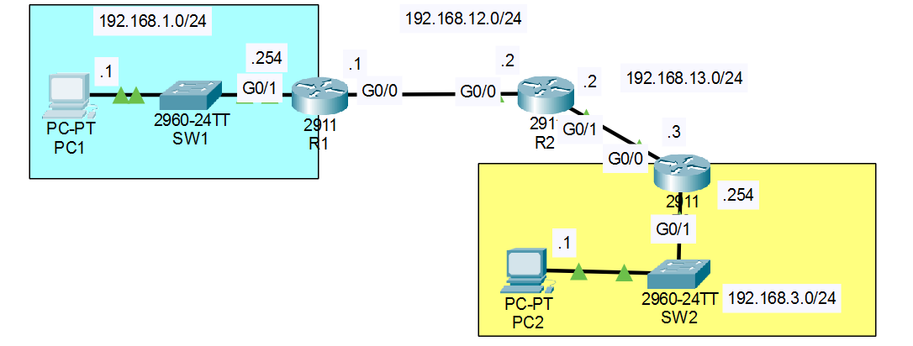

# Day 04 — Static Routing

**Jeremy's IT Lab:** Day 11 (theory) + Day 15 Lab (VLSM with static routes) | **Topic:** N10-009 Obj 2.1 — Routing
**Difficulty:** 🟡 Medium 


## 🎯 Objective
All devices start with **no pre-configurations** :
1. Configure all PCs and routers according to the network diagram (hostnames, interface IP addresses, and PC default gateways). Switches do not require configuration.
2. Configure static routes on the routers to enable PC1 to successfully ping PC2.


## 🖧 Topology



## 📋 Routing Table Overview

A router needs a static route for every network it is **not directly connected to**:

| Network | Subnet Mask | Next Hop | Configured On |
|---|---|---|---|
| 192.168.13.0 | 255.255.255.0 | 192.168.12.2 | Router 1 |
| 192.168.3.0 | 255.255.255.0 | 192.168.12.2 | Router 1 |
| 192.168.1.0 | 255.255.255.0 | 192.168.12.1 | Router 2 |
| 192.168.3.0 | 255.255.255.0 | 192.168.13.3 | Router 2 |
| 192.168.1.0 | 255.255.255.0 | 192.168.13.2 | Router 3 |
| 192.168.12.0 | 255.255.255.0 | 192.168.13.2 | Router 3 |


## ⚙️ CLI Configuration Commands

```bash
# === ROUTER 1 ===
R1# configure terminal
R1(config)# ip route 192.168.13.0 255.255.255.0 192.168.12.2
R1(config)# ip route 192.168.3.0 255.255.255.0 192.168.12.2

# === ROUTER 2 (Middle Router) ===
R2# configure terminal
R2(config)# ip route 192.168.1.0 255.255.255.0 192.168.12.1
R2(config)# ip route 192.168.3.0 255.255.255.0 192.168.13.3

# === ROUTER 3 ===
R3# configure terminal
R3(config)# ip route 192.168.1.0 255.255.255.0 192.168.13.2
R3(config)# ip route 192.168.12.0 255.255.255.0 192.168.13.2
```


## ✅ Verification Results
- PC1 (`192.168.1.1`) → its own gateway (`192.168.1.254`): ✅
- PC1 → R2 interface (`192.168.12.2`) / R3 interface (`192.168.13.3`): ✅ / ❌
- PC1 (`192.168.1.1`) → PC2 (`192.168.3.1`): ✅ / ❌
- Traceroute shows correct hops (R1 → R2 → R3 → PC2): ✅ / ❌

**Test order:** own gateway (`192.168.1.254`) → next-hop router (`192.168.12.2`) → remote router interface (`192.168.13.3`) → remote PC (`192.168.3.1`).


## 💡 What I Learned
- In a multi-router topology, **every router along the path** (including intermediate routers like R2) must have routes to networks it is not directly connected to, or packets will be dropped midway.
- A ping requires a **complete forward and return route path** across all routers in the chain.
- The **destination** of an `ip route` command is always the remote **network address** (`192.168.3.0`), never a specific host IP.
- The **next hop** is always the immediate *neighboring router's* IP address on the shared link, not the local router's own interface.
- Static routes will fail if the end hosts do not have their **default gateway** configured correctly. Routing always starts at the PC.
- The first ping may time out while ARP resolves across multiple hops. That's normal.
- Verify routing tables with `show ip route`: look for static (`S`) entries across all routers.

## ❌ Mistakes I Made

| Symptom | Cause | Fix |
|---|---|---|
| `% Invalid input detected at '^' marker` on `ip route` | Typed it at `R1#` (privileged mode) instead of global configuration mode | `configure terminal` first, so the prompt is `R1(config)#` |
| Route went nowhere useful | Used a **host address** or local interface (`g0/0`) as the next hop instead of the neighbor router's IP | Destination = network address (`192.168.3.0`). Next hop = neighboring router's link IP (`192.168.12.2`) |
| PC1 pinged its gateway, but remote traffic dropped at R2 | **The middle router (R2) was missing static routes** for either LAN1 or LAN3 | Ensure intermediate routers have explicit static routes for networks they cannot see directly |


## 📎 Files
- `static-routing.pkt` — Packet Tracer file (my copy of *Day 11 Lab - Configuring Static Routes*)

---
*Source: Jeremy's IT Lab Day 11 and Day 15 Lab | N10-009 Obj 2.1*


