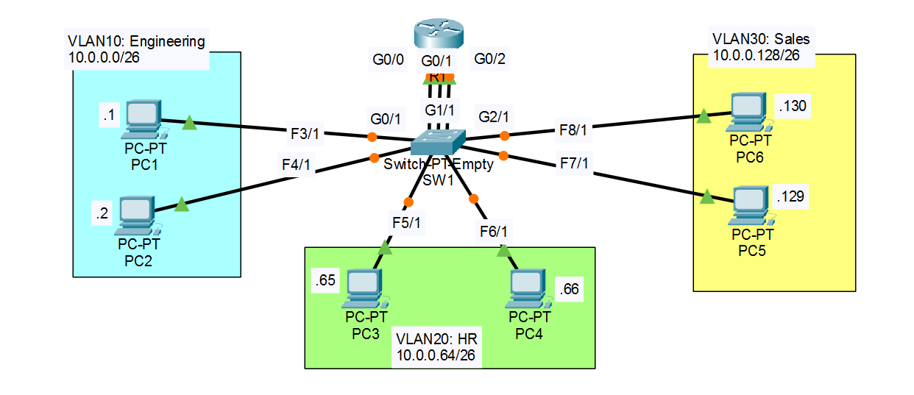

# Day 05 — VLANs

**Jeremy's IT Lab:** Day 16 (VLANs Part 1) + Day 16 Lab | **Topic:** N10-009 Obj 2.3 — VLANs
**Difficulty:** 🔴 Hard

---

## 🎯 Objective
Create three VLANs on one switch, put each department's PCs in its own VLAN, connect each VLAN to its own router interface, and use a broadcast ping to see that a VLAN is a separate broadcast domain.

## 🖧 Topology


## 📝 Lab Tasks
1. Configure the IP address and mask on each PC. Set the gateway to the **last usable** address of the subnet.
2. Make **three connections** between R1 and SW1. Configure one interface on R1 for each VLAN, using the gateway addresses from the PCs.
3. Configure SW1's interfaces in the proper VLANs, **including the ports that connect to R1**. Name the VLANs (Engineering, HR, Sales).
4. Ping between the PCs. Send a **broadcast ping** from a PC (to the subnet broadcast address) and use **Simulation Mode** to see which devices receive it.

---

## 📋 Step 1: PC and router addressing

| Device | Interface | IP Address | Subnet Mask | Default Gateway |
|---|---|---|---|---|
| PC1 | NIC | 10.0.0.1 | 255.255.255.192 | 10.0.0.62 |
| PC2 | NIC | 10.0.0.2 | 255.255.255.192 | 10.0.0.62 |
| PC3 | NIC | 10.0.0.65 | 255.255.255.192 | 10.0.0.126 |
| PC4 | NIC | 10.0.0.66 | 255.255.255.192 | 10.0.0.126 |
| PC5 | NIC | 10.0.0.129 | 255.255.255.192 | 10.0.0.190 |
| PC6 | NIC | 10.0.0.130 | 255.255.255.192 | 10.0.0.190 |
| R1 | G0/0 | 10.0.0.62 | 255.255.255.192 | — |
| R1 | G0/1 | 10.0.0.126 | 255.255.255.192 | — |
| R1 | G0/2 | 10.0.0.190 | 255.255.255.192 | — |

The gateway is the **last usable** address of each subnet, and it is the R1 interface for that VLAN.

## 📋 Steps 2 and 3: VLANs and ports

| VLAN | Name | Subnet | Broadcast | SW1 ports | R1 port |
|---|---|---|---|---|---|
| 10 | Engineering | 10.0.0.0/26 | 10.0.0.63 | G0/1, F3/1 (PC1), F4/1 (PC2) | G0/0 ↔ SW1 G0/1 |
| 20 | HR | 10.0.0.64/26 | 10.0.0.127 | G1/1, F5/1 (PC3), F6/1 (PC4) | G0/1 ↔ SW1 G1/1 |
| 30 | Sales | 10.0.0.128/26 | 10.0.0.191 | G2/1, F7/1 (PC5), F8/1 (PC6) | G0/2 ↔ SW1 G2/1 |

The three links to R1 are **access ports**, one in each VLAN. There is no trunk in this lab.

## ⚙️ Key Commands Used

```bash
# R1: one interface per VLAN, address = the PCs' gateway
R1(config)# interface g0/0
R1(config-if)# ip address 10.0.0.62 255.255.255.192
R1(config-if)# no shutdown
R1(config-if)# interface g0/1
R1(config-if)# ip address 10.0.0.126 255.255.255.192
R1(config-if)# no shutdown
R1(config-if)# interface g0/2
R1(config-if)# ip address 10.0.0.190 255.255.255.192
R1(config-if)# no shutdown

# SW1: create and name the VLANs
SW1(config)# vlan 10
SW1(config-vlan)# name Engineering
SW1(config-vlan)# vlan 20
SW1(config-vlan)# name HR
SW1(config-vlan)# vlan 30
SW1(config-vlan)# name Sales
SW1(config-vlan)# exit

# SW1: access ports (router-facing port + the two PC ports of each VLAN)
SW1(config)# interface range g0/1, f3/1, f4/1
SW1(config-if-range)# switchport mode access
SW1(config-if-range)# switchport access vlan 10
SW1(config-if-range)# interface range g1/1, f5/1, f6/1
SW1(config-if-range)# switchport mode access
SW1(config-if-range)# switchport access vlan 20
SW1(config-if-range)# interface range g2/1, f7/1, f8/1
SW1(config-if-range)# switchport mode access
SW1(config-if-range)# switchport access vlan 30

# Verify
SW1# show vlan brief
R1# show ip interface brief
PC> ipconfig
PC> ping 10.0.0.66          # PC1 → PC4, a different VLAN, through R1
PC> ping 10.0.0.63          # broadcast ping to VLAN 10
```

No routes are needed: each subnet is **directly connected** to an R1 interface.

## ✅ Verification Results
- `show vlan brief` shows the named VLANs with the right ports: ✅ / ❌
- R1 interfaces up/up: ✅ / ❌
- Ping within a VLAN (PC1 → PC2): ✅ / ❌
- Ping between VLANs through R1 (PC1 → PC4): ✅ / ❌
- Broadcast ping from PC1 (`10.0.0.63`) is received only by **VLAN 10** devices (PC2 and R1's G0/0), not VLAN 20 or 30: ✅ / ❌


## 💡 What I Learned
- A **VLAN is a separate broadcast domain**. A broadcast stays inside its VLAN.
- The switch never forwards between VLANs. **R1 does the routing**, so traffic between VLANs goes PC → SW1 → R1 → SW1 → PC.
- In this design each VLAN needs its **own physical link and router interface**. Router-on-a-stick (one trunk) comes in Day 06.
- The ports that connect to R1 must also be in the right VLAN.
- Set the port mode explicitly with `switchport mode access`.
- `show vlan brief` is the quick check for VLAN names and port membership.
- The gateway is the router interface in the PC's own VLAN.


## 📎 Files
- `Day 16 Lab - VLANs (Part 1).pkt` — Packet Tracer file

---
*Source: Jeremy's IT Lab Day 16 | N10-009 Obj 2.3*
