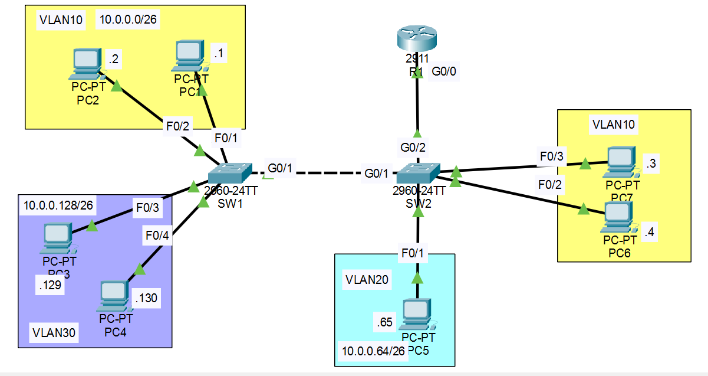
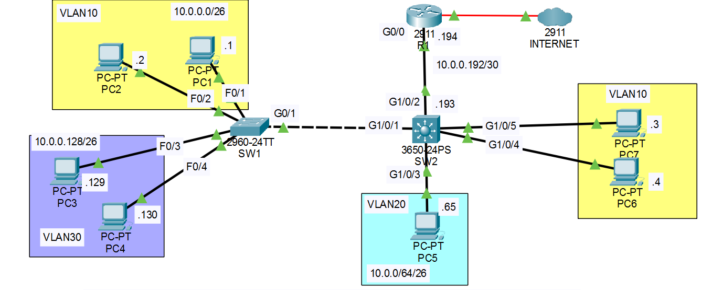

# Day 06 — Inter-VLAN Routing

**Jeremy's IT Lab:** Day 17 Lab (Router-on-a-Stick) + Day 18 Lab (SVIs) | **Topic:** N10-009 Obj 2.3 — Inter-VLAN Routing
**Difficulty:** 🔴 Hard 

---

## 🎯 Objective
Route between VLANs two ways and compare them:
1. **Day 17 lab:** two switches joined by a trunk, with **router-on-a-stick (ROAS)** on R1.
2. **Day 18 lab:** replace ROAS with a **point-to-point Layer 3 link** and **SVIs** on a multilayer switch (SW2), then reach the Internet (`1.1.1.1`).

## 📋 Addressing (both labs)

| VLAN | Subnet | Gateway (last usable) | PCs |
|---|---|---|---|
| 10 | 10.0.0.0/26 | 10.0.0.62 | PC1 .1, PC2 .2, PC7 .3, PC6 .4 |
| 20 | 10.0.0.64/26 | 10.0.0.126 | PC5 .65 |
| 30 | 10.0.0.128/26 | 10.0.0.190 | PC3 .129, PC4 .130 |

Mask for all: `255.255.255.192` (/26).

---

# Lab 1: Day 17 — Trunk + Router-on-a-Stick

## 🖧 Topology


## 📝 Lab Tasks
1. Configure the switch interfaces connected to PCs as **access ports** in the correct VLAN.
2. Configure SW1–SW2 as a **trunk**, allowing only the necessary VLANs, with an **unused VLAN as the native VLAN**. Make sure all necessary VLANs **exist on each switch**.
3. Configure SW2–R1 using **router-on-a-stick**, giving R1's subinterfaces the **last usable** address of each subnet.
4. Test connectivity by pinging between PCs. All PCs should reach each other.

## 📋 Ports and trunks

| Switch | Ports | VLAN |
|---|---|---|
| SW1 | F0/1–F0/2 (PC1, PC2) | 10 |
| SW1 | F0/3–F0/4 (PC3, PC4) | 30 |
| SW2 | F0/1 (PC5) | 20 |
| SW2 | F0/2–F0/3 (PC6, PC7) | 10 |

| Trunk | Allowed VLANs | Native VLAN |
|---|---|---|
| SW1 G0/1 ↔ SW2 G0/1 | **10, 30** (VLAN 20 has no hosts on SW1) | 1001 (unused) |
| SW2 G0/2 ↔ R1 G0/0 | 10, 20, 30 | 1001 (unused) |

VLANs needed: **SW1** 10, 30. **SW2** 10, 20 **and 30** (VLAN 30 has no hosts on SW2, but its traffic passes through it to reach R1).

## ⚙️ Key Commands Used

```bash
# Step 1: VLANs and access ports
SW1(config)# vlan 10
SW1(config)# vlan 30
SW1(config)# interface range f0/1 - 2
SW1(config-if-range)# switchport mode access
SW1(config-if-range)# switchport access vlan 10
SW1(config-if-range)# interface range f0/3 - 4
SW1(config-if-range)# switchport mode access
SW1(config-if-range)# switchport access vlan 30

SW2(config)# vlan 10
SW2(config)# vlan 20
SW2(config)# vlan 30                      # needed even with no VLAN 30 hosts on SW2
SW2(config)# interface f0/1
SW2(config-if)# switchport mode access
SW2(config-if)# switchport access vlan 20
SW2(config-if)# interface range f0/2 - 3
SW2(config-if-range)# switchport mode access
SW2(config-if-range)# switchport access vlan 10

# Step 2: trunk SW1–SW2 (same on both ends)
SW1(config)# interface g0/1
SW1(config-if)# switchport mode trunk
SW1(config-if)# switchport trunk allowed vlan 10,30
SW1(config-if)# switchport trunk native vlan 1001

# Step 3: ROAS
SW2(config)# interface g0/2
SW2(config-if)# switchport mode trunk
SW2(config-if)# switchport trunk allowed vlan 10,20,30
R1(config)# interface g0/0
R1(config-if)# no shutdown                # parent port: no IP address
R1(config)# interface g0/0.10
R1(config-subif)# encapsulation dot1q 10
R1(config-subif)# ip address 10.0.0.62 255.255.255.192
# repeat: g0/0.20 → dot1q 20 → 10.0.0.126, g0/0.30 → dot1q 30 → 10.0.0.190

# Step 4: verify
SW1# show vlan brief
SW1# show interfaces trunk
R1# show ip interface brief
PC> ping [PC in another VLAN]
```

## ✅ Verification Results
- `show interfaces trunk`: VLANs 10,30 under "allowed **and active**" on both switches, native VLAN 1001: ✅ / ❌
- R1 subinterfaces `.10 .20 .30` up/up: ✅ / ❌
- All PCs reach each other: ✅ / ❌


---

# Lab 2: Day 18 — Point-to-Point Layer 3 + SVIs

## 🖧 Topology


All devices start preconfigured from the end of Day 17, except **SW2 is now a 3650 multilayer switch**. Hosts are in the right VLANs, SW1–SW2 is a trunk, and R1–SW2 uses ROAS.

## 📝 Lab Tasks
1. Replace the ROAS configuration on R1–SW2 with a **point-to-point Layer 3 connection** using the diagram's IPs. Add a **default route on SW2** with R1's G0/0 as the next hop.
2. Configure **SVIs on SW2**, one per VLAN, using the **last usable** address of each subnet.
3. Test inter-VLAN connectivity by pinging between VLANs.
4. Test the Internet by pinging `1.1.1.1` (routes are already configured on R1 and the Internet router).

## 📋 New addressing

| Device | Interface | IP Address | Mask |
|---|---|---|---|
| R1 | G0/0 | 10.0.0.194 | 255.255.255.252 |
| SW2 | G1/0/2 (routed port) | 10.0.0.193 | 255.255.255.252 |
| SW2 | `interface vlan 10` | 10.0.0.62 | 255.255.255.192 |
| SW2 | `interface vlan 20` | 10.0.0.126 | 255.255.255.192 |
| SW2 | `interface vlan 30` | 10.0.0.190 | 255.255.255.192 |

The link between R1 and SW2 is `10.0.0.192/30`. SW2's PC ports are G1/0/3 (PC5), G1/0/4 (PC6), G1/0/5 (PC7).

## ⚙️ Key Commands Used

```bash
# Step 1: R1, remove ROAS and address the physical port
R1(config)# no interface g0/0.10          # then .20 and .30
R1(config)# interface g0/0
R1(config-if)# ip address 10.0.0.194 255.255.255.252
R1(config-if)# no shutdown

# Step 1: SW2, routed port + default route (next hop = R1's address)
SW2(config)# interface g1/0/2
SW2(config-if)# no switchport
SW2(config-if)# ip address 10.0.0.193 255.255.255.252
SW2(config-if)# no shutdown
SW2(config)# ip routing
SW2(config)# ip route 0.0.0.0 0.0.0.0 10.0.0.194

# Step 2: SW2, one SVI per VLAN
SW2(config)# interface vlan 10
SW2(config-if)# ip address 10.0.0.62 255.255.255.192
SW2(config-if)# no shutdown
# repeat: vlan 20 → 10.0.0.126, vlan 30 → 10.0.0.190

# Steps 3 and 4: verify
SW2# show ip interface brief
SW2# show ip route
PC> ping [PC in another VLAN]
PC> ping 1.1.1.1
```

SW2's table should show `C` lines for the three VLANs and the /30, and `S* 0.0.0.0/0 [1/0] via 10.0.0.194`.

## ✅ Verification Results
- SVIs and the routed port up/up: ✅
- PC → R1 `10.0.0.194` works: ✅
- Ping between VLANs: ✅
- `ping 1.1.1.1`: ✅ (after fixing the default route)


---

## 💡 What I Learned
- **Different VLANs always need Layer 3.** A switch never forwards between VLANs on its own.
- A VLAN needs three things on every switch it crosses: it **exists**, it is **allowed** on the trunk, and the **native VLAN matches**. `show interfaces trunk` shows this under "allowed and active".
- **ROAS path (VLAN 10 → VLAN 30):** host → SW2 → **R1** → SW2 → SW1 → host.
- **SVI path:** host → **SW2 (routes it)** → SW1 → host. No trip to the router.
- A **routed port** (`no switchport`) is not a trunk, and an **SVI** is the VLAN's gateway on the switch.
- An SVI only comes up if its VLAN exists and a port in that VLAN is up. A multilayer switch only routes after `ip routing`.
- The **next hop** of a default or static route must be a real device address, never the network address.

## ❌ Mistakes I Made

| Symptom | Cause | Fix |
|---|---|---|
| (Lab 1) Ping to `10.0.0.190` timed out even though R1's subinterfaces were up | **VLAN 30 missing on SW2.** It has no hosts there, but its traffic passes through SW2, so the VLAN must exist | `vlan 30` on SW2 |
| (Lab 1) Trunks showed `Native vlan 1` | The lab wants an **unused** native VLAN | `switchport trunk native vlan 1001` on **both** ends |
| (Lab 1) SW2's trunk to SW1 allowed `10,20,30` | The lab says allow only the necessary VLANs | `switchport trunk allowed vlan 10,30` |
| (Lab 2) `no interface vlan 10` on R1 | `interface vlan` is an **SVI**, which belongs on SW2. On R1 the VLAN gateways are **subinterfaces** | `no interface g0/0.10` (then `.20`, `.30`) |
| (Lab 2) Inter-VLAN and R1 pings worked, but `ping 1.1.1.1` timed out | SW2's default route pointed to **10.0.0.192**, the /30 **network address** | `no ip route 0.0.0.0 0.0.0.0 10.0.0.192`, then `ip route 0.0.0.0 0.0.0.0 10.0.0.194` |

## 📎 Files
- `intervlan-routing.pkt` — Packet Tracer file, Day 17 lab (ROAS)
- `intervlan-svi.pkt` — Packet Tracer file, Day 18 lab (SVIs)

---
*Source: Jeremy's IT Lab Day 17 Lab and Day 18 Lab | N10-009 Obj 2.3*
