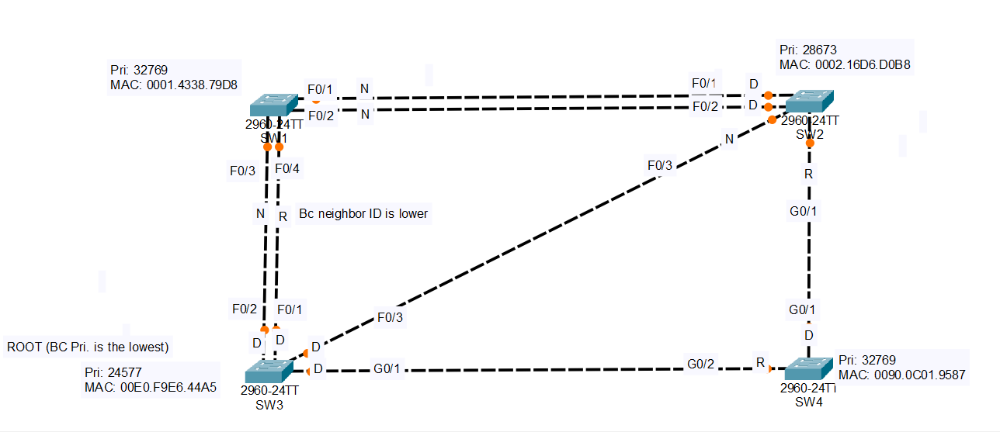
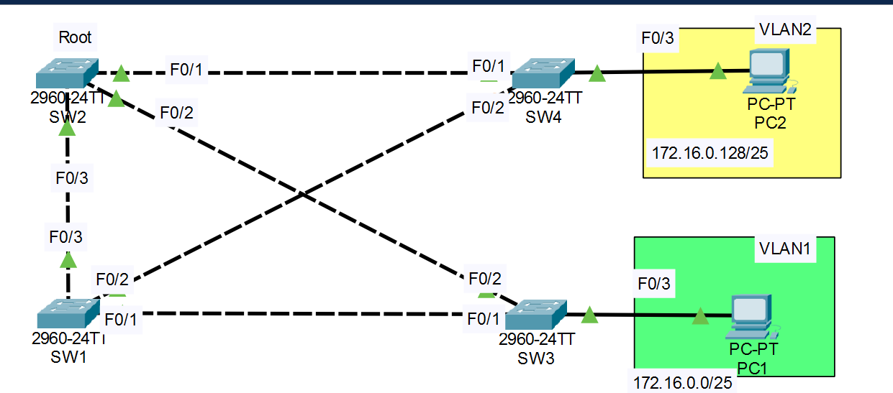

# Day 07 — Spanning Tree Protocol (STP)

**Jeremy's IT Lab:** Day 20 Lab - Analyzing STP + Day 21 Lab - Configuring Spanning Tree 
<br>**Topic:** N10-009 Obj 2.3 — STP 
 | **Difficulty:** 🔴 Hard 

---

## 🎯 Objective
Observe how STP prevents Layer 2 loops by blocking redundant paths. **Lab 20** finds the root bridge and the role of every port by reading the topology, then confirms it in the CLI. **Lab 21** configures STP: a different root per VLAN, port cost and priority changes, and PortFast with BPDU Guard.

---

# Lab 1: Day 20 Lab - Analyzing STP

## 🖧 Topology


> Turn off link lights in Packet Tracer for this lab: **Options > Preferences > Show Link Lights**.

## 📝 Lab Tasks
1. Which switch is the **root bridge**?
2. Identify the role (**root / designated / non-designated**) of each switch port.
3. Confirm your answers in the CLI.

## 📋 Bridge IDs

The priority shown is the configured priority plus the VLAN number (24576 + 1 = 24577 for VLAN 1).

| Switch | Priority | MAC Address | Result |
|---|---|---|---|
| SW1 | 32769 | 0001.4338.79D8 | |
| SW2 | 28673 | 0002.16D6.D0B8 | |
| **SW3** | **24577** | 00E0.F9E6.44A5 | **Root bridge** (lowest priority) |
| SW4 | 32769 | 0090.0C01.9587 | |

## 📋 Links

| Link | Speed |
|---|---|
| SW1 F0/1 ↔ SW2 F0/1 | FastEthernet |
| SW1 F0/2 ↔ SW2 F0/2 | FastEthernet |
| SW1 F0/3 ↔ SW3 F0/2 | FastEthernet |
| SW1 F0/4 ↔ SW3 F0/1 | FastEthernet |
| SW2 F0/3 ↔ SW3 F0/3 | FastEthernet |
| SW2 G0/1 ↔ SW4 G0/1 | Gigabit |
| SW3 G0/1 ↔ SW4 G0/2 | Gigabit |

## 📋 Port Roles

| Switch | Port | Role |
|---|---|---|
| SW1 | F0/1 | Non-designated |
| SW1 | F0/2 | Non-designated |
| SW1 | F0/3 | Non-designated |
| SW1 | F0/4 | **Root** |
| SW2 | F0/1 | Designated |
| SW2 | F0/2 | Designated |
| SW2 | F0/3 | Non-designated |
| SW2 | G0/1 | **Root** |
| SW3 | F0/1 | Designated |
| SW3 | F0/2 | Designated |
| SW3 | F0/3 | Designated |
| SW3 | G0/1 | Designated |
| SW4 | G0/1 | Designated |
| SW4 | G0/2 | **Root** |

### How I worked it out
1. **Root bridge:** the lowest bridge ID wins, and SW3 has the lowest priority. **All of the root bridge's ports are designated.**
2. **Root port** on each other switch = the port with the lowest cost to the root. Costs: FastEthernet **19**, Gigabit **4**.
   - **SW4:** G0/2 goes straight to SW3 over gigabit, cost 4.
   - **SW2:** G0/1 goes through SW4 for 4 + 4 = **8**, which beats the direct FastEthernet link to SW3 (19).
   - **SW1:** F0/3 and F0/4 both reach SW3 directly at cost 19. It's a tie, so the **lower neighbor port ID** wins. F0/4 connects to SW3's F0/1, which is lower than F0/2, so F0/4 is the root port.
3. **Designated port** on each link = the side with the lower cost to the root.
   - SW2 (cost 8) beats SW1 (cost 19), so SW2's F0/1 and F0/2 are designated.
   - SW4 (cost 4) beats SW2 (cost 8), so SW4's G0/1 is designated.
4. Everything left is **non-designated** (it blocks): SW1 F0/1, F0/2, F0/3 and SW2 F0/3.

## ⚙️ Key Commands Used

```bash
SW3# show spanning-tree
SW3# show spanning-tree vlan 1
# Look for "This bridge is the root", and the Role / Sts / Cost / Prio.Nbr columns
# Root = Root, Designated = Desg, Non-designated = Altn (BLK)
```

## ✅ Verification Results
- CLI confirms SW3 is the root bridge: ✅ / ❌
- My port roles match `show spanning-tree` on every switch: ✅ / ❌


---

# Day 21 Lab - Configuring Spanning Tree

## 🖧 Topology


Four switches in a full mesh of trunks, with **SW2 as the starting root**. PC1 (VLAN 1, `172.16.0.0/25`) is on SW3 F0/3 and PC2 (VLAN 2, `172.16.0.128/25`) is on SW4 F0/3.

| Link | Ports |
|---|---|
| SW1 ↔ SW2 | F0/3 ↔ F0/3 |
| SW1 ↔ SW3 | F0/1 ↔ F0/1 |
| SW1 ↔ SW4 | F0/2 ↔ F0/2 |
| SW2 ↔ SW3 | F0/2 ↔ F0/2 |
| SW2 ↔ SW4 | F0/1 ↔ F0/1 |

## 📝 Lab Tasks
1. Use the CLI to check the current STP topology. What is the root bridge? What is the role/state of each port on each switch?
2. Configure **SW1** as the **primary root for VLAN 1** and **secondary for VLAN 2**. Configure **SW2** as the **primary root for VLAN 2** and **secondary for VLAN 1**. What is the role/state of each port now?
3. Increase the **VLAN 1 cost** of SW4's F0/2 to 100. Does SW4 select a different root port? Why or why not?
4. Increase the **VLAN 1 port priority** of SW1's F0/1 to 240. Does SW3 select a different root port? Why or why not?
5. Configure **PortFast and BPDU Guard** on the F0/3 interfaces of SW3 and SW4.

## 📋 Task 1: Starting topology (VLAN 1)

Root bridge: **SW2** (the root bridge's ports are all designated).

| Switch | Port | STP Role | STP State |
|---|---|---|---|
| SW1 | F0/1 | | |
| SW1 | F0/2 | | |
| SW1 | F0/3 | | |
| SW2 | F0/1 | Designated | Forwarding |
| SW2 | F0/2 | Designated | Forwarding |
| SW2 | F0/3 | Designated | Forwarding |
| SW3 | F0/1 | | |
| SW3 | F0/2 | | |
| SW4 | F0/1 | | |
| SW4 | F0/2 | | |

*(Fill in what you observed. The result depends on the switches' MAC addresses.)*

## 📋 Task 2: After the root change

Expected result, confirm it with `show spanning-tree vlan 1` and `vlan 2`. Costs are 19 on every FastEthernet link.

| Switch | Port | VLAN 1 (root SW1) | VLAN 2 (root SW2) |
|---|---|---|---|
| SW1 | F0/1 | Designated / FWD | Designated / FWD |
| SW1 | F0/2 | Designated / FWD | Designated / FWD |
| SW1 | F0/3 | Designated / FWD | **Root** / FWD |
| SW2 | F0/1 | Designated / FWD | Designated / FWD |
| SW2 | F0/2 | Designated / FWD | Designated / FWD |
| SW2 | F0/3 | **Root** / FWD | Designated / FWD |
| SW3 | F0/1 | **Root** / FWD | **Alternate / BLK** |
| SW3 | F0/2 | **Alternate / BLK** | **Root** / FWD |
| SW4 | F0/1 | **Alternate / BLK** | **Root** / FWD |
| SW4 | F0/2 | **Root** / FWD | **Alternate / BLK** |

Each VLAN blocks a **different** link, so the traffic is shared across the links.

## ⚙️ Key Commands Used

```bash
# Task 1: check the topology
SW1# show spanning-tree
SW1# show spanning-tree vlan 1
SW1# show spanning-tree | include Root

# Task 2: root per VLAN
SW1(config)# spanning-tree vlan 1 root primary
SW1(config)# spanning-tree vlan 2 root secondary
SW2(config)# spanning-tree vlan 2 root primary
SW2(config)# spanning-tree vlan 1 root secondary

# Task 3: cost on SW4 F0/2 (VLAN 1)
SW4(config)# interface f0/2
SW4(config-if)# spanning-tree vlan 1 cost 100

# Task 4: port priority on SW1 F0/1 (VLAN 1)
SW1(config)# interface f0/1
SW1(config-if)# spanning-tree vlan 1 port-priority 240

# Task 5: PortFast + BPDU Guard on the PC ports (SW3 and SW4)
SW3(config)# interface f0/3
SW3(config-if)# spanning-tree portfast
SW3(config-if)# spanning-tree bpduguard enable
# repeat on SW4 F0/3

# Verify
SW4# show spanning-tree vlan 1
SW3# show spanning-tree interface f0/3 detail
SW3# show running-config interface f0/3
```

## ✅ Verification Results
- Root bridge is SW2 at the start: ✅ / ❌
- After Task 2: SW1 is root for VLAN 1 and SW2 is root for VLAN 2: ✅ / ❌
- Each VLAN has a different blocked link: ✅ / ❌
- Task 3: SW4's VLAN 1 root port changes: ✅ / ❌
- Task 4: SW3's VLAN 1 root port does not change: ✅ / ❌
- PortFast and BPDU Guard show as enabled on F0/3: ✅ / ❌


---

## 💡 What I Learned
- STP elects the **root bridge** with the lowest **bridge ID** (priority + MAC). With PVST+ this is done **per VLAN**, and the priority shows as 32768 + the VLAN number (32769 for VLAN 1).
- **Costs:** FastEthernet 19, Gigabit 4. A faster link has a lower cost.
- The **root bridge's ports are all designated**.
- Each non-root switch picks one **root port** (lowest cost to the root). On each link the side with the lower cost to the root is **designated**. Everything else is **non-designated (alternate / blocking)**, which is what stops loops.
- Root port tie-break order: lowest root path cost → lowest sender bridge ID → lowest sender port priority → lowest sender port number.
- `root primary` and `root secondary` are shortcuts that lower the bridge priority.
- Different roots per VLAN make different links block, so no link sits idle for every VLAN.
- **Lab 2, task 3 (cost):** SW4's root port **changes**. After the cost is 100 on F0/2, that path costs 100, while the path via F0/1 and SW2 costs 19 + 19 = 38. The lower cost wins.
- **Lab 2, task 4 (port priority):** SW3's root port **does not change**. SW3 reaches the root directly through F0/1 at cost 19, versus 38 through SW2. Port priority is only a **tie-breaker**.
- **PortFast** puts an edge port straight into forwarding, and **BPDU Guard** shuts it down if a BPDU arrives. Use both on ports that go to PCs.


## 📎 Files
- `Day 20 Lab - Analyzing STP.pkt` — Packet Tracer file, Lab 1 (Day 20)
- `Day 21 Lab - Configuring Spanning Tree.pkt` — Packet Tracer file, Lab 2 (configuration)

---
*Source: Jeremy's IT Lab Day 20 & Day 21 | N10-009 Obj 2.3*
